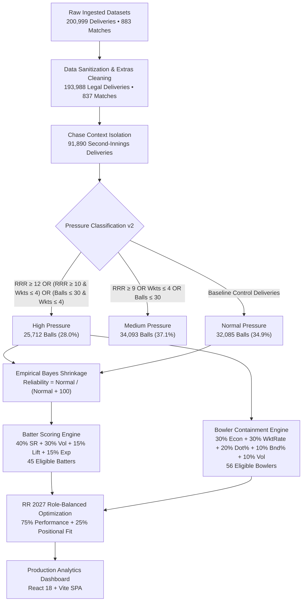

# SupeRR Selector Season 2 — Rajasthan Royals IPL 2027 Analytics Dashboard

> **Data-driven IPL pressure-performance analytics and Rajasthan Royals auction intelligence dashboard.**

[](https://github.com/VayuTripathi09/My-SupeRR-Selector-Season-2)
[](https://www.typescriptlang.org/)
[](https://react.dev/)
[](https://vitejs.dev/)
[](https://tailwindcss.com/)
[](LICENSE)

---

## 1. Project Overview

**SupeRR Selector Season 2** is a franchise-grade sports intelligence dashboard developed specifically for the **Rajasthan Royals (RR) IPL 2027 Auction Strategy**. The platform is designed to identify, evaluate, and rank cricket players who demonstrate statistically verifiable reliability under extreme match pressure during second-innings run chases.

Inspired by premier enterprise data portals (Linear, Stripe Analytics, Palantir, and Databricks), the application provides a modern, responsive, high-density analytics interface combining multi-factor pressure classifications, Empirical Bayes shrinkage, and algorithmic role-balanced squad optimization.

---

## 2. Problem Statement

Modern T20 franchise recruitment frequently overvalues overall career averages and strike rates compiled in low-leverage situations. In the IPL, playoff qualifications and trophy campaigns are disproportionately decided in high-pressure chase scenarios where Required Run Rate (RRR) exceeds 12.0 or multiple top-order wickets have fallen.

Traditional metrics suffer from two fundamental analytical failures:
1. **Leverage Distortion**: Runs scored when 30 are needed off 40 balls are weighted identically to runs scored when 36 are needed off 12 balls.
2. **Small-Sample Asymmetry**: Specialist finishers (e.g., David Miller, Rinku Singh) enter exclusively in extreme late-overs contexts, resulting in tiny, noisy normal-pressure baselines that distort raw "pressure lift" calculations.

The **SupeRR Selector** platform solves these problems through an audited, deterministic analytical pipeline.

---

## 3. Key Features

- **Executive KPI Dashboard**: Immediate high-level visibility across 842 players, 837 matches, 193,988 legal deliveries, 25,712 high-pressure balls, and top-rated clutch performers.
- **Audited Pressure Analytics Engine**: Interactive breakdown of second-innings chase deliveries across High (28.0%), Medium (37.1%), and Normal (34.9%) leverage states, with phase-wise distribution (Powerplay, Middle, Death).
- **Interactive Batter Leaderboard**: Complete rankings for all 45 eligible batters featuring multi-column sorting, franchise/role filtering, strike rates, volume, reliable pressure lift, and one-click CSV export.
- **Interactive Bowler Leaderboard**: Complete rankings for all 56 eligible bowlers evaluating economy under pressure, wickets per over, dot ball percentage, boundary avoidance, and Rajasthan Royals positional quota fits.
- **Universal Player Explorer**: Directory indexing all 842 match-active players with detailed High/Medium/Normal performance splits, historical radar charts, and transparent qualification audit trails.
- **Head-to-Head Player Comparison**: Side-by-side comparative matrix supporting up to 3 players with automated leader highlighting and situational benchmark bar charts.
- **Deterministic Pressure Predictor Sandbox**: Interactive simulation allowing scouts to dial in custom Required Run Rates (4–24), Wickets in Hand (1–10), and Balls Remaining (6–120) to evaluate live rule triggers and historical cohort distributions.
- **Scientific Methodology Documentation**: Transparent mathematical formulations detailing extras sanitation, Empirical Bayes prior shrinkage, and percentile weighting schemes.
- **Data Catalog & Technical Specifications**: Complete schema tables, record counts, file sizes, and boundary limitations for all ingested datasets.

---

## 4. Technology Stack

### Frontend & Analytics UI
- **Framework**: [React 18.3](https://react.dev/) + [TypeScript 5.7](https://www.typescriptlang.org/)
- **Bundler & Dev Server**: [Vite 6.1](https://vitejs.dev/)
- **Styling**: [Tailwind CSS 3.4](https://tailwindcss.com/) with PostCSS & Autoprefixer
- **Visualizations**: [Recharts 2.15](https://recharts.org/) (ResponsiveContainer, BarChart, LineChart, PieChart, ScatterChart)
- **Icons**: [Lucide React](https://lucide.dev/)
- **Typography**: Inter (Body), Manrope (Headings), JetBrains Mono (Telemetry/Tabular Data)

### Data Engineering & Verification
- **Python**: 3.10+ (Pandas, NumPy)
- **Data Generation**: `generate_dashboard_data.py` (deterministic JSON compilation)
- **Verification Test Suite**: `verify_dashboard.py` (5 automated audit test suites)
- **Research Notebook**: `SupeRR_PressureIQ_01_Data_Audit.ipynb`

---

## 5. System Architecture



---

## 6. Data Processing Methodology

The project ingests historical match and delivery data spanning all IPL and T20 International (T20I) tournaments from 2022 to 2026:
1. **Raw Volume**: 200,999 raw delivery records across 883 recorded matches.
2. **Scope Filter**: Filtered to `analysis_format in ['IPL', 'T20I']` across regular innings 1 and 2 (Super Overs and abandoned matches excluded), producing **193,988 legal analysis deliveries** across **837 matches**.
3. **Extras Sanitation**: Non-delivery penalty events (5 penalty runs awarded without an active ball) were isolated from bowler and batter statistics. Wides and no-balls were classified as non-legal deliveries that charge runs to the bowler without incrementing legal balls faced.
4. **Second-Innings Chase Restriction**: Pressure is modeled strictly in second innings (**91,890 qualifying deliveries**) because chases provide deterministic targets and verifiable required run rates.

---

## 7. Pressure Classification Rules (Model v2)

Before each delivery in a chase, game-state leverage is evaluated across three vectors:

### High Pressure (28.0% of chase deliveries / 25,712 balls)
- `Required Run Rate ≥ 12.0`
- `OR (Required Run Rate ≥ 10.0 AND Wickets Remaining ≤ 4)`
- `OR (Balls Remaining ≤ 30 AND Wickets Remaining ≤ 4)`

### Medium Pressure (37.1% of chase deliveries / 34,093 balls)
- `Required Run Rate ≥ 9.0`
- `OR Wickets Remaining ≤ 4`
- `OR Balls Remaining ≤ 30` *(excluding High Pressure deliveries)*

### Normal Pressure (34.9% of chase deliveries / 32,085 balls)
- All other qualifying second-innings deliveries (`Runs Required > 0`, `Balls Remaining > 0`).

---

## 8. Batter and Bowler Ranking Methodology

> **Methodological Standard**: The ranking system relies entirely on **deterministic composite scoring and Empirical Bayes shrinkage**. No black-box machine learning models were trained or serialized.

### Batter Qualification & Scoring
- **Eligibility Threshold**: Must have faced **≥ 60 high-pressure balls** across **≥ 8 distinct high-pressure matches** in IPL chases. Exactly **45 batters** qualified.
- **Empirical Bayes Shrinkage**:
  $$\text{Baseline Reliability} = \frac{\text{Normal Balls}}{\text{Normal Balls} + 100}$$
  $$\text{Reliable Pressure Lift} = (\text{High SR} - \text{Normal SR}) \times \text{Baseline Reliability}$$
- **Final Batter Score (4-Component Percentile)**:
  $$\text{Score} = 0.40 \cdot \text{High SR} + 0.30 \cdot \text{High Balls} + 0.15 \cdot \text{Reliable Lift} + 0.15 \cdot \text{Matches}$$

#### Top 5 Batters (Audited):
1. **Namboori Tilak Varma**: Score `89.11` | High SR: `179.13`
2. **David Miller**: Score `88.44` | High SR: `201.73`
3. **Rinku Singh**: Score `87.00` | High SR: `199.49`
4. **Marcus Stoinis**: Score `80.89` | High SR: `176.99`
5. **Tristan Stubbs**: Score `76.22` | High SR: `191.82`

---

### Bowler Qualification & Scoring
- **Eligibility Threshold**: Must have delivered **≥ 60 legal high-pressure balls** across **≥ 8 distinct high-pressure matches** in IPL chases. Exactly **56 bowlers** qualified.
- **Final Bowler Score (5-Component Inverted Percentile)**:
  $$\text{Score} = 0.30 \cdot \text{Inverted Economy} + 0.30 \cdot \text{Wickets Per Over} + 0.20 \cdot \text{Dot } \% + 0.10 \cdot \text{Inverted Boundary } \% + 0.10 \cdot \text{High Balls}$$

#### Top 5 Bowlers (Audited):
1. **Eshan Malinga**: Score `86.43` | Economy: `7.90` | Wickets: `16`
2. **Mohit Sharma**: Score `85.36` | Economy: `7.96` | Wickets: `19`
3. **Varun Chakravarthy**: Score `84.64` | Economy: `8.58` | Wickets: `20`
4. **Mohsin Khan**: Score `82.86` | Economy: `7.65` | Wickets: `8`
5. **Matheesha Pathirana**: Score `78.39` | Economy: `7.99` | Wickets: `16`

---

## 9. Installation and Setup

### Prerequisites
- **Node.js**: `v18.0.0` or higher (`v22+` recommended)
- **npm**: `v9.0.0` or higher
- **Python**: `3.10+` (optional, only required to re-run raw data extraction)

### Clone & Install
```bash
git clone https://github.com/VayuTripathi09/My-SupeRR-Selector-Season-2.git
cd My-SupeRR-Selector-Season-2

# Install project dependencies
npm install
```

---

## 10. Environment Configuration

Copy the example configuration file:
```bash
cp .env.example .env
```

Contents of `.env.example`:
```env
NODE_ENV=production
PORT=3000
HOST=127.0.0.1
VITE_APP_TITLE="SupeRR Selector Season 2 — Rajasthan Royals IPL 2027 Intelligence"
VITE_APP_VERSION="2.4.0"
```

---

## 11. Running Locally

### Development Server (Hot Module Replacement)
```bash
npm run dev
```
Open [http://localhost:3000](http://localhost:3000) in your browser.

### Production Build & Preview
```bash
# Typecheck and compile production bundle into dist/
npm run build

# Preview optimized production build
npm run preview
```

### Data Pipeline & Verification (Python)
```bash
# Re-generate typed dashboard JSON datasets from raw CSVs
python generate_dashboard_data.py

# Run the 5 automated verification audit test suites
python verify_dashboard.py
```

---

## 12. Production Deployment

The project is structured as a standalone Single-Page Application (SPA) with precompiled JSON data stores. It can be deployed with zero server maintenance on any modern cloud hosting platform:

### Deploy to Vercel (Recommended)
1. Push your repository to GitHub.
2. Import the repository into [Vercel](https://vercel.com).
3. The included `vercel.json` automatically configures Vite build settings and SPA rewrites.
4. Click **Deploy**.

### Deploy to Netlify
1. Connect your repository to [Netlify](https://netlify.com).
2. Set Build Command: `npm run build`
3. Set Publish Directory: `dist`
4. Click **Deploy Site**.

### Deploy to GitHub Pages
1. In `vite.config.ts`, set `base: '/My-SupeRR-Selector-Season-2/'`.
2. Run `npm run build` and deploy the `dist/` directory via the `gh-pages` branch.

---

## 13. Limitations and Disclaimers

1. **Second-Innings Chase Restriction**: First-innings deliveries are excluded from pressure ranking because the absence of a fixed target renders required run rate subjective.
2. **Finisher Sample Asymmetry**: Lower-order batters face limited low-pressure balls. Empirical Bayes shrinkage corrects this, but ongoing multi-season monitoring is advised.
3. **No Affiliation Disclaimer**: This project is an independent sports analytics research platform designed for the SupeRR Selector competition and is not officially affiliated with or endorsed by the Rajasthan Royals, BCCI, or Indian Premier League.

---

## 14. Future Improvements

- **Win Probability Added (WPA)**: Integrating machine learning win-probability models to score first-innings leverage.
- **Matchup Ball Tracking**: Trajectory and ball-pitch heatmaps for batter vs. bowler phase-specific matchups.
- **Auction Budget Simulator**: Real-time purse constraint solver balancing squad quotas against projected player price distributions.

---

## License

This project is licensed under the MIT License — see the [LICENSE](LICENSE) file for details.
